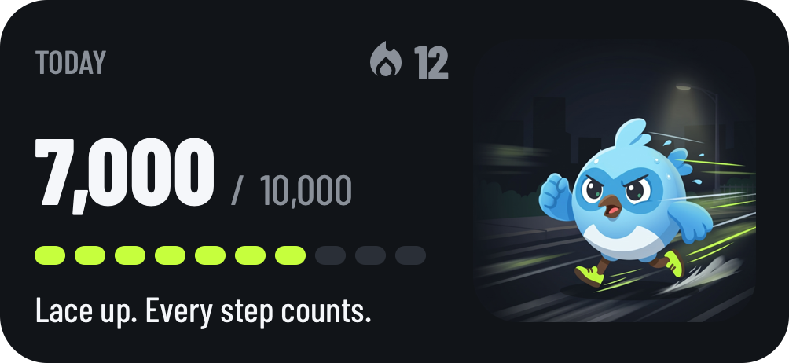
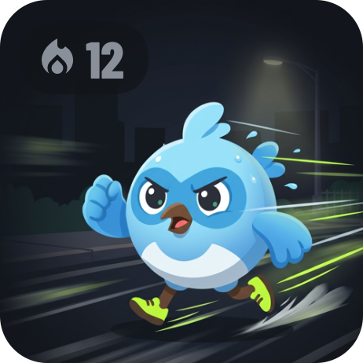
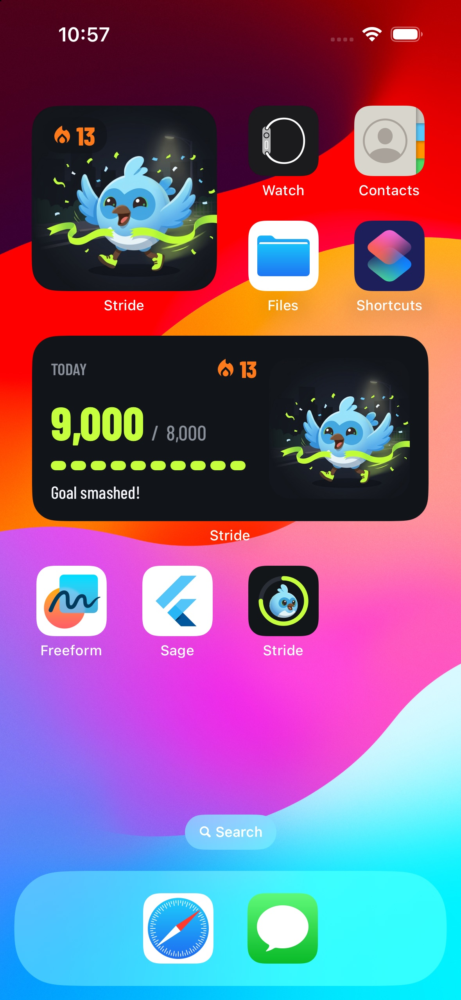
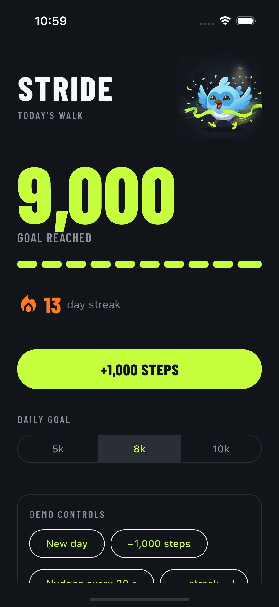
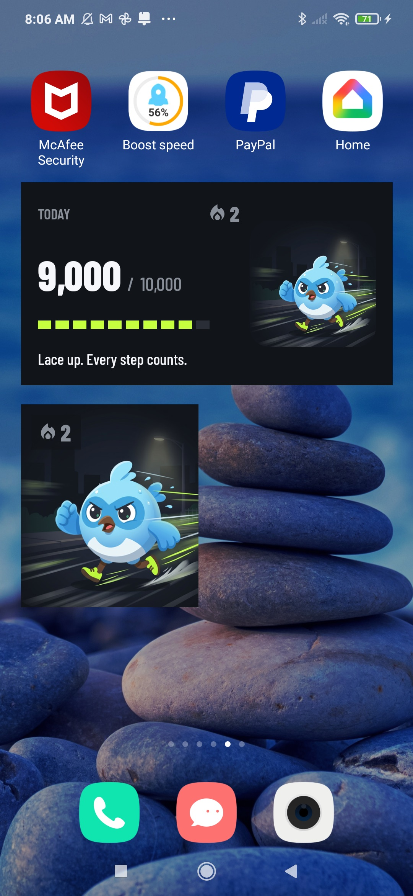

# Flutter home screen widgets

Demo app and slides for the talk **"Building Home Screen Widgets in Flutter Without Writing Native Code Twice"** by Akansha Jain, at flutterCon India 2026.

The idea: describe a home screen widget **once, in Dart**, and generate the native SwiftUI (iOS) and Jetpack Glance (Android) code from it with [`home_widget_generator`](https://pub.dev/packages/home_widget_generator) and [`home_widget_cli`](https://pub.dev/packages/home_widget_cli).

<p align="center">
  
  &nbsp;
  
</p>

## Screenshots

| iOS home screen | The app | Android home screen |
| :---: | :---: | :---: |
|  |  |  |
| Goal reached: Dash celebrates | Steps, streak and demo controls | The same two widgets on Android 10 |

## What's inside

| Folder | What it is |
| --- | --- |
| [`stride/`](stride/) | **Stride**, a small step-goal app with two home screen widgets (a wide one and a small streak one) for iOS and Android |
| [`stride/home_widget/`](stride/home_widget/) | The two widget descriptions in Dart: `stride.dart` and `streak.dart` |
| [`stride/lib/widget_sync.dart`](stride/lib/widget_sync.dart) | Where the app saves data for the widgets and asks them to redraw |
| [`slides/`](slides/) | The talk slides (open `slides/index.html` in a browser) |

## The three packages

| Package | Job | In `pubspec.yaml` |
| --- | --- | --- |
| [`home_widget`](https://pub.dev/packages/home_widget) | Saves data for the widget, asks the phone to redraw it, and tells the app when the widget is tapped | `dependencies` (ships in your app) |
| [`home_widget_generator`](https://pub.dev/packages/home_widget_generator) | The building blocks (`HWText`, `HWRow`, `HWImage`…) you describe the widget with | `dev_dependencies` |
| [`home_widget_cli`](https://pub.dev/packages/home_widget_cli) | Reads the description and writes the Swift, the Kotlin, a Dart helper class and the native setup | `dev_dependencies` |

## Run the demo

You need Flutter, plus Xcode for iOS or an Android device or emulator.

```bash
cd stride
flutter pub get
flutter run
```

Then add the widgets: long-press the home screen, search for **Stride**, and add both widgets.

In the app:

- **+1,000 STEPS** adds steps; both widgets update.
- **Tap a widget** to open the app on a "Back from a walk?" sheet.
- **Demo controls** at the bottom: start a new day, remove steps, change the streak, and **Nudges every 30 s**, which saves a timetable with entries 30 seconds apart so you can watch the widget change with the app closed.

## Change the widget

1. Edit a description in [`stride/home_widget/`](stride/home_widget/), for example the `'TODAY'` label in `stride.dart`.
2. Generate the native code:

   ```bash
   cd stride
   dart run home_widget_cli:home_widget generate
   ```

3. Do a full `flutter run`. Hot reload and hot restart can't update the widget, because it's native code.

The generated files are committed (`stride/lib/src/home_widget/`, plus the Swift and Kotlin in `ios/` and `android/`), so you can compare a description with what it produces.

## Things to know

- **Real iPhone:** the app and the widget share data through an App Group, and App Groups need a paid Apple Developer account. The iOS Simulator works without one. To run on your own device, change `groupId` (`group.dev.akanshajain.stride`) in both widget files to your own App Group, run `generate` again, and check signing in Xcode.
- **`path_provider_android` is pinned to `2.2.23`** in `pubspec.yaml`. With 2.3.x, saving files failed on an Android 10 phone (`ClassNotFoundException`), so the widgets never updated.
- **Android 11 and older ignore the widget's cell size** and only read `minWidth`/`minHeight`, so the wide widget sets `minWidth: 250, minHeight: 110`.
- **Listen for widget taps in one place.** Taps arrive through a single native connection that keeps only one listener; a second listener replaces the first.
- **The generator is before 1.0**, so expect breaking changes. Buttons on the widget still need native code.

## Tested with

`home_widget` 0.10.0, `home_widget_generator` 0.4.0+1 and `home_widget_cli` 0.4.0+1, on Flutter 3.47.8 (Dart 3.13.7). Tested on the iOS 17 Simulator (iPhone 15 Pro) and on a Xiaomi Redmi Note 7 Pro (Android 10).

## Slides

Open [`slides/index.html`](slides/index.html) in a browser; the fonts, images and demo videos are all included, so it works offline.

- **Arrow keys** or **Space**: next and previous slide
- **Click a video** or press **K**: play and pause
- **J** / **L**: back and forward 5 seconds

## Credits

`home_widget`, `home_widget_generator` and `home_widget_cli` are by [Anton Borries](https://github.com/ABausG). To build your first generated widget step by step, try his codelab: [abausg.github.io/workshop_home_widget_in_dart](https://abausg.github.io/workshop_home_widget_in_dart).

Dash is the Flutter mascot.
